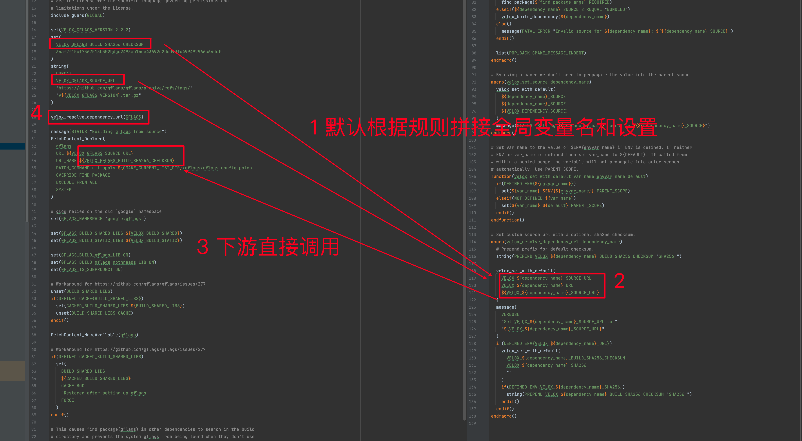
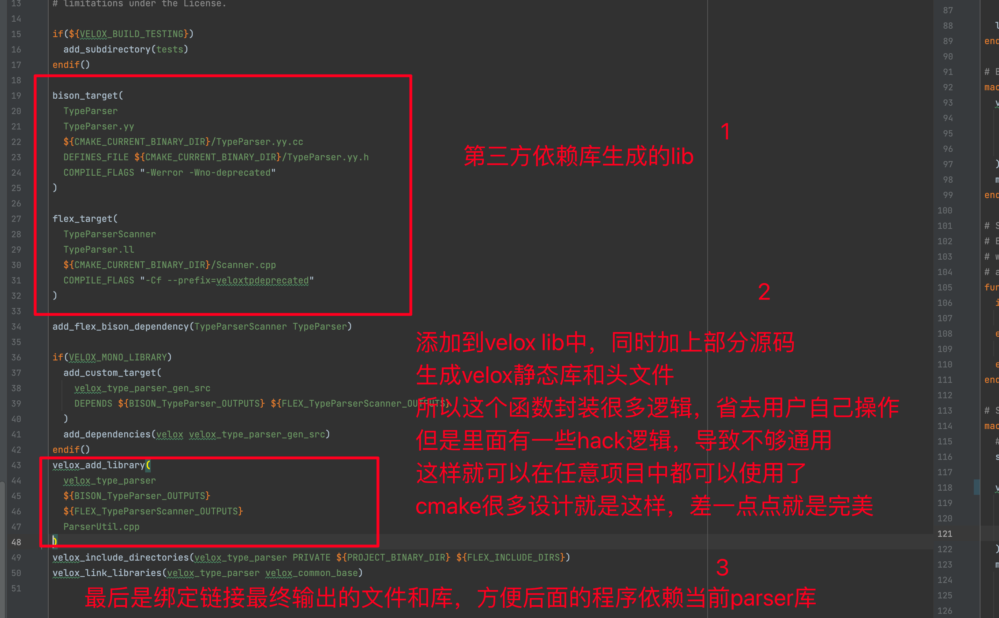

## 背景
velox有一套自己的cmake编译和第三方管理库流程
考虑到需要集成到不同系统环境
为降低学习成本，需要简单梳理一下

## 问题
1. cmake最大的问题，就是很多变量你不知道从哪里冒出来，在哪里使用，已经有什么作用
2. 导致你需要花大量不必要的时间，去深入看。对比java pom.xml管理就很清晰
3. c++ 本质上，就应该是确定版本号或者commit号，确定安装目录 bin lib include即可
4. 管理好这几个变量，就能游刃有余，但是不明白c++ 为什么一直做不多，基本上每个大型项目，都要自己维护一套cmake 和 third party

## 前置定义
1. 默认安装路径设置这个 CMAKE_INSTALL_PREFIX 全局唯一
   1. 但是有些第三方库，不规范，自己二次定义 CMAKE_INSTALL_PREFIX，这样就无法输出到我希望的目录
   2. 这也是为什么cmake效率低，还得找到这类不规范的库，然后再重置

## 自定义函数
### velox封装解析依赖的函数
1. velox_set_with_default
2. velox_build_dependency
3. velox_resolve_dependency
4. velox_resolve_dependency_url
5. 
```shell

# 定义一个函数，用于设置变量的默认值
function(velox_set_with_default var_name envvar_name default)
  if(DEFINED ENV{${envvar_name}})
    # 如果环境变量已定义，使用其值
    set(${var_name} $ENV{${envvar_name}} PARENT_SCOPE)
  elseif(NOT DEFINED ${var_name})
    # 如果变量未定义，使用默认值
    set(${var_name} ${default} PARENT_SCOPE)
  endif()
endfunction()

# 定义一个宏，用于设置依赖项的来源
macro(velox_set_source dependency_name)
  # 使用默认值设置依赖项的来源
  velox_set_with_default(
    ${dependency_name}_SOURCE
    ${dependency_name}_SOURCE
    ${VELOX_DEPENDENCY_SOURCE}
  )
  # 输出当前设置的依赖项来源
  message(STATUS "Setting ${dependency_name} source to ${${dependency_name}_SOURCE}")
endmacro()


# 定义一个宏，用于构建依赖项
macro(velox_build_dependency dependency_name)
  # 将依赖项名称转换为小写
  string(TOLOWER ${dependency_name} dependency_name_lower)
  # 包含对应的依赖项配置文件
  include(${dependency_name_lower})
endmacro()


# 定义一个宏，用于解析第三方依赖项
macro(velox_resolve_dependency dependency_name)
  # 在消息输出中添加缩进以便于阅读
  list(APPEND CMAKE_MESSAGE_INDENT "[${dependency_name}] ")

  # 准备find_package的参数列表
  set(find_package_args ${dependency_name} ${ARGN})
  list(REMOVE_ITEM find_package_args REQUIRED QUIET)

  # 根据依赖项的来源进行不同的处理
  if(${dependency_name}_SOURCE STREQUAL "AUTO")
    # 尝试通过find_package查找依赖项
    find_package(${find_package_args})
    if(${${dependency_name}_FOUND})
      # 如果找到，设置来源为SYSTEM
      set(${dependency_name}_SOURCE "SYSTEM")
    else()
      # 如果未找到，设置来源为BUNDLED并构建依赖项
      set(${dependency_name}_SOURCE "BUNDLED")
      velox_build_dependency(${dependency_name})
    endif()
    # 输出使用的依赖项来源
    message(STATUS "Using ${${dependency_name}_SOURCE} ${dependency_name}")
  elseif(${dependency_name}_SOURCE STREQUAL "SYSTEM")
    # 强制通过find_package查找依赖项
    find_package(${find_package_args} REQUIRED)
  elseif(${dependency_name}_SOURCE STREQUAL "BUNDLED")
    # 强制从源代码构建依赖项
    velox_build_dependency(${dependency_name})
  else()
    # 如果来源设置无效，抛出错误
    message(FATAL_ERROR "Invalid source for ${dependency_name}: ${${dependency_name}_SOURCE}")
  endif()

  # 移除消息缩进
  list(POP_BACK CMAKE_MESSAGE_INDENT)
endmacro()


# 定义一个宏，用于设置自定义源URL和可选的sha256校验和
macro(velox_resolve_dependency_url dependency_name)
  # 为默认校验和添加前缀
  string(PREPEND VELOX_${dependency_name}_BUILD_SHA256_CHECKSUM "SHA256=")

  # 使用默认值设置源URL
  velox_set_with_default(
    VELOX_${dependency_name}_SOURCE_URL
    VELOX_${dependency_name}_URL
    ${VELOX_${dependency_name}_SOURCE_URL}
  )
  # 输出设置的源URL
  message(
    VERBOSE
    "Set VELOX_${dependency_name}_SOURCE_URL to "
    "${VELOX_${dependency_name}_SOURCE_URL}"
  )
  if(DEFINED ENV{VELOX_${dependency_name}_URL})
    # 如果环境变量定义了URL，设置校验和
    velox_set_with_default(
      VELOX_${dependency_name}_BUILD_SHA256_CHECKSUM
      VELOX_${dependency_name}_SHA256
      ""
    )
    if(DEFINED ENV{VELOX_${dependency_name}_SHA256})
      # 如果环境变量定义了SHA256，添加前缀
      string(PREPEND VELOX_${dependency_name}_BUILD_SHA256_CHECKSUM "SHA256=")
    endif()
  endif()
endmacro()
```


### velox封装的添加库依赖的函数
1. velox_add_library 编译库并按照头文件
2. 示例
3. 
```shell

include_guard(GLOBAL)  # 防止重复包含同一个文件，确保全局唯一性。

include(CMakePackageConfigHelpers)  # 包含CMake的包配置助手模块，用于生成配置文件。

function(velox_get_rpath_origin VAR)  # 定义函数velox_get_rpath_origin，获取RPATH的起始路径。
  if(APPLE)  # 如果是苹果系统（macOS），则设置_origin为@loader_path。
    set(_origin @loader_path)
  else()  # 否则，设置_origin为$ORIGIN，用于其他系统。
    set(_origin "\$ORIGIN")
  endif()
  set(${VAR} ${_origin} PARENT_SCOPE)  # 将_origin的值设置到传入的变量VAR中，并在父作用域中可见。
endfunction()

function(pyvelox_add_module TARGET)  # 定义函数pyvelox_add_module，用于创建Python模块。
  pybind11_add_module(${TARGET} ${ARGN})  # 使用pybind11创建Python模块，TARGET为模块名，ARGN为其他参数。

  if(DEFINED SKBUILD_PROJECT_VERSION_FULL)  # 如果定义了SKBUILD_PROJECT_VERSION_FULL变量。
    target_compile_definitions(${TARGET} PRIVATE PYVELOX_VERSION=${SKBUILD_PROJECT_VERSION_FULL})  # 设置模块的编译定义，指定版本号。
  else()  # 否则。
    target_compile_definitions(${TARGET} PRIVATE PYVELOX_VERSION=dev)  # 设置模块的编译定义，版本号为dev。
  endif()

  # Set the rpath so linker looks within pyvelox package for libs
  velox_get_rpath_origin(_origin)  # 调用velox_get_rpath_origin函数，获取RPATH的起始路径。
  set_target_properties(
    ${TARGET}
    PROPERTIES INSTALL_RPATH "${_origin}/;${CMAKE_BINARY_DIR}/lib" INSTALL_RPATH_USE_LINK_PATH TRUE
  )  # 设置目标的属性，指定安装RPATH和使用链接路径。
  install(TARGETS ${TARGET} LIBRARY DESTINATION pyvelox COMPONENT pyvelox_libraries)  # 安装目标模块到指定目录。
endfunction()

# TODO use file sets
function(velox_install_library_headers)  # 定义函数velox_install_library_headers，用于安装库的头文件。
  # Find any headers and install them relative to the source tree in include.
  file(GLOB _hdrs "*.h")  # 搜索当前目录下的所有.h头文件。
  if(NOT "${_hdrs}" STREQUAL "")  # 如果找到头文件。
    cmake_path(
      RELATIVE_PATH
      CMAKE_CURRENT_SOURCE_DIR
      BASE_DIRECTORY "${CMAKE_SOURCE_DIR}"
      OUTPUT_VARIABLE _hdr_dir
    )  # 计算头文件相对于源目录的路径。
    install(FILES ${_hdrs} DESTINATION include/${_hdr_dir})  # 安装头文件到指定的include目录。
  endif()
endfunction()

# Base add velox library call to add a library and install it.
function(velox_base_add_library TARGET)  # 定义基础函数velox_base_add_library，用于创建和安装库。
  add_library(${TARGET} ${ARGN})  # 创建一个库目标，TARGET为库名，ARGN为其他参数。
  install(TARGETS ${TARGET} DESTINATION lib/velox)  # 安装库到指定的lib/velox目录。
  velox_install_library_headers()  # 调用velox_install_library_headers函数，安装库的头文件。
endfunction()

# This is extremely hackish but presents an easy path to installation.
function(velox_add_library TARGET)  # 定义函数velox_add_library，用于创建和安装库。
  set(options OBJECT STATIC SHARED INTERFACE)  # 定义可选的库类型选项。
  set(oneValueArgs)  # 初始化单值参数列表。
  set(multiValueArgs)  # 初始化多值参数列表。
  cmake_parse_arguments(VELOX "${options}" "${oneValueArgs}" "${multiValueArgs}" ${ARGN})  # 解析传入的参数。

  # Remove library type specifiers from ARGN
  set(library_type)  # 初始化库类型变量。
  if(VELOX_OBJECT)  # 如果指定了OBJECT类型。
    set(library_type OBJECT)  # 设置库类型为OBJECT。
  elseif(VELOX_STATIC)  # 如果指定了STATIC类型。
    set(library_type STATIC)  # 设置库类型为STATIC。
  elseif(VELOX_SHARED)  # 如果指定了SHARED类型。
    set(library_type SHARED)  # 设置库类型为SHARED。
  elseif(VELOX_INTERFACE)  # 如果指定了INTERFACE类型。
    set(library_type INTERFACE)  # 设置库类型为INTERFACE。
  endif()

  list(REMOVE_ITEM ARGN OBJECT)  # 从参数列表中移除OBJECT。
  list(REMOVE_ITEM ARGN STATIC)  # 从参数列表中移除STATIC。
  list(REMOVE_ITEM ARGN SHARED)  # 从参数列表中移除SHARED。
  list(REMOVE_ITEM ARGN INTERFACE)  # 从参数列表中移除INTERFACE。
  # Propagate to the underlying add_library and then install the target.
  if(VELOX_MONO_LIBRARY)  # 如果启用了单库模式。
    if(TARGET velox)  # 如果目标velox已经存在。
      # Target already exists, append sources to it.
      target_sources(velox PRIVATE ${ARGN})  # 将源文件追加到现有的velox目标中。
      if(VELOX_BUILD_PYTHON_PACKAGE)  # 如果启用了Python包构建。
        install(TARGETS velox LIBRARY DESTINATION pyvelox COMPONENT pyvelox_libraries)  # 安装velox库到指定目录。
      endif()
    else()  # 如果目标velox不存在。
      set(_type STATIC)  # 默认设置库类型为STATIC。
      if(VELOX_BUILD_SHARED)  # 如果启用了共享库构建。
        set(_type SHARED)  # 设置库类型为SHARED。
      endif()
      # Create the target if this is the first invocation.
      add_library(velox ${_type} ${ARGN})  # 创建velox库目标。
      set_target_properties(velox PROPERTIES LIBRARY_OUTPUT_DIRECTORY ${PROJECT_BINARY_DIR}/lib)  # 设置库的输出目录。
      set_target_properties(velox PROPERTIES ARCHIVE_OUTPUT_DIRECTORY ${PROJECT_BINARY_DIR}/lib)  # 设置归档输出目录。
      install(TARGETS velox DESTINATION lib/velox EXPORT velox_targets)  # 安装velox库并导出目标。
      if(VELOX_BUILD_CMAKE_PACKAGE)  # 如果启用了CMake包构建。
        set(package_cmake_dir "lib/cmake/Velox")  # 设置CMake包目录。
        set(config_cmake_in "${PROJECT_SOURCE_DIR}/CMake/VeloxConfig.cmake.in")  # 设置配置文件模板路径。
        set(config_cmake "${PROJECT_BINARY_DIR}/CMake/VeloxConfig.cmake")  # 设置配置文件输出路径。
        configure_package_config_file(
          "${config_cmake_in}"
          "${config_cmake}"
          INSTALL_DESTINATION "${package_cmake_dir}"
        )  # 配置包配置文件。
        install(FILES "${config_cmake}" DESTINATION "${package_cmake_dir}")  # 安装配置文件到指定目录。
        set(system_dependencies)  # 初始化系统依赖列表。
        if(Arrow_SOURCE STREQUAL "SYSTEM")  # 如果Arrow来源于系统。
          list(APPEND system_dependencies Arrow)  # 将Arrow添加到系统依赖列表。
        endif()
        if(glog_SOURCE STREQUAL "SYSTEM")  # 如果glog来源于系统。
          list(APPEND system_dependencies glog)  # 将glog添加到系统依赖列表。
        endif()
        if(VELOX_ENABLE_COMPRESSION_LZ4)  # 如果启用了LZ4压缩。
          list(APPEND system_dependencies lz4)  # 将lz4添加到系统依赖列表。
        endif()
        if(re2_SOURCE STREQUAL "SYSTEM")  # 如果re2来源于系统。
          list(APPEND system_dependencies re2)  # 将re2添加到系统依赖列表。
        endif()
        if(stemmer_SOURCE STREQUAL "SYSTEM")  # 如果stemmer来源于系统。
          list(APPEND system_dependencies stemmer)  # 将stemmer添加到系统依赖列表。
        endif()
        if(VELOX_BUILD_MINIMAL_WITH_DWIO OR VELOX_ENABLE_HIVE_CONNECTOR)  # 如果启用了DWIO或Hive连接器。
          list(APPEND system_dependencies Snappy zstd)  # 将Snappy和zstd添加到系统依赖列表。
        endif()
        foreach(system_dependency ${system_dependencies})  # 遍历系统依赖。
          set(velox_find_module "${PROJECT_SOURCE_DIR}/CMake/Find${system_dependency}.cmake")  # 设置Find模块路径。
          if(EXISTS "${velox_find_module}")  # 如果Find模块存在。
            install(FILES "${velox_find_module}" DESTINATION "${package_cmake_dir}")  # 安装Find模块到指定目录。
          endif()
        endforeach()
        # TODO: We can enable this once we add version to Velox.
        # set(version_cmake "${PROJECT_BINARY_DIR}/CMake/VeloxConfigVersion.cmake")
        # write_basic_package_version_file("${version_cmake}"
        #                                  COMPATIBILITY SameMajorVersion)
        # install(FILES "${version_cmake}" DESTINATION "${package_cmake_dir}")
        install(
          EXPORT velox_targets
          DESTINATION "${package_cmake_dir}"
          NAMESPACE "Velox::"
          FILE "VeloxTargets.cmake"
        )  # 导出并安装velox目标。
      endif()
    endif()
    # create alias for compatability
    if(NOT TARGET ${TARGET})  # 如果目标不存在。
      add_library(${TARGET} ALIAS velox)  # 创建目标的别名。
    endif()
  else()  # 如果没有启用单库模式。
    # Create a library for each invocation.
    velox_base_add_library(${TARGET} ${library_type} ${ARGN})  # 调用基础函数创建库。
  endif()
  velox_install_library_headers()  # 安装库的头文件。
endfunction()

function(velox_link_libraries TARGET)  # 定义函数velox_link_libraries，用于链接库。
  # TODO(assignUser): Handle scope keywords (they currently are empty calls ala
  # target_link_libraries(target PRIVATE))
  if(VELOX_MONO_LIBRARY)  # 如果启用了单库模式。
    # These targets follow the velox_* name for consistency but are NOT actually
    # aliases to velox when building the mono lib and need to be linked
    # explicitly (this is a hack)
    set(
      explicit_targets
      velox_exec_test_lib
      # see velox/experimental/wave/README.md
      velox_wave_common
      velox_wave_decode
      velox_wave_dwio
      velox_wave_exec
      velox_wave_stream
      velox_wave_vector
    )  # 定义需要显式链接的目标列表。

    foreach(_arg ${ARGN})  # 遍历传入的参数。
      list(FIND explicit_targets ${_arg} _explicit)  # 查找参数是否在显式目标列表中。
      if(_explicit EQUAL -1 AND "${_arg}" MATCHES "^velox_*")  # 如果参数不在显式目标列表中且匹配velox_*。
        message(DEBUG "\t\tDROP: ${_arg}")  # 输出调试信息，表示丢弃该参数。
      else()  # 否则。
        message(DEBUG "\t\tADDING: ${_arg}")  # 输出调试信息，表示添加该参数。
        target_link_libraries(velox ${_arg})  # 将参数链接到velox库。
      endif()
    endforeach()
  else()  # 如果没有启用单库模式。
    target_link_libraries(${TARGET} ${ARGN})  # 将参数链接到指定目标。
  endif()
endfunction()

function(velox_include_directories TARGET)  # 定义函数velox_include_directories，用于设置包含目录。
  if(VELOX_MONO_LIBRARY)  # 如果启用了单库模式。
    target_include_directories(velox ${ARGN})  # 设置velox库的包含目录。
  else()  # 如果没有启用单库模式。
    target_include_directories(${TARGET} ${ARGN})  # 设置指定目标的包含目录。
  endif()
endfunction()

function(velox_compile_definitions TARGET)  # 定义函数velox_compile_definitions，用于设置编译定义。
  if(VELOX_MONO_LIBRARY)  # 如果启用了单库模式。
    target_compile_definitions(velox ${ARGN})  # 设置velox库的编译定义。
  else()  # 如果没有启用单库模式。
    target_compile_definitions(${TARGET} ${ARGN})  # 设置指定目标的编译定义。
  endif()
endfunction()

function(velox_sources TARGET)  # 定义函数velox_sources，用于添加源文件。
  if(VELOX_MONO_LIBRARY)  # 如果启用了单库模式。
    target_sources(velox ${ARGN})  # 将源文件添加到velox库。
  else()  # 如果没有启用单库模式。
    target_sources(${TARGET} ${ARGN})  # 将源文件添加到指定目标。
  endif()
endfunction()

```


### 用户如何添加依赖
1. cpp的依赖分三类源文件，头文件和库文件，对于java来说只需要jar，这也是一层理解成本
2. 源文件
   1. 
3. 头文件
   1. include_directories
4. 库文件
   1. add_library
   2. add_dependencies
   3. link_directories
```shell

# 头文件路径
include_directories("/share/wangzixian/github/velox/_build/release")

# 链接静态库路径
link_directories("/usr/lib64")


file(GLOB LIBRARIES64 "${LIBRARY64_DIR}/*.a")
file(GLOB LIBRARIES "${LIBRARY_DIR}/*.a")

```


### 用户如何构建一个可执行的文件
1. add_executable
2. target_link_libraries
```shell

add_executable(velox_example_opaque_type OpaqueType.cpp)
target_link_libraries(
  velox_example_opaque_type
  velox_type
  velox_vector
  velox_caching
  velox_expression
  velox_memory
)


add_executable(velox_example_operator_extensibility OperatorExtensibility.cpp)
target_link_libraries(
  velox_example_operator_extensibility
  velox_type
  velox_vector
  velox_exec
  velox_exec_test_lib
  velox_memory
  velox_vector_test_lib
)

```


### 用户如何构建一个静态库 / 动态库
```shell

# 动态库只需要改成 add_library(MyDynamicLib SHARED ${SOURCES})
add_library(arrow STATIC IMPORTED GLOBAL):
    arrow: 定义一个名为 arrow 的库目标。
    STATIC: 指定这个库是一个静态库。
    IMPORTED: 表示这个库是一个导入的库，而不是由当前CMake项目构建的。这通常用于引用外部构建的库。
    GLOBAL: 使这个导入的库在所有CMake目录中可见，而不仅仅是在定义它的目录中。

add_dependencies(arrow arrow_ep):
    为 arrow 目标添加一个依赖项 arrow_ep。这意味着在构建 arrow 之前，CMake会确保 arrow_ep 已经构建完成。
    arrow_ep 通常是一个构建步骤或目标，可能是一个外部项目或构建过程的一部分

target_include_directories(arrow PUBLIC include)

# 可选：设置编译选项
# target_compile_options(MyStaticLib PRIVATE -Wall -Wextra)

```

## Velox
1. 基于上面一些velox自定义函数了解
2. 第一件事就是梳理变量
3. 找到
### 
```shell

```


### 
```shell

```


### 
```shell

```


### 
```shell

```


### 
```shell

```


### 
```shell

```


### 
```shell

```


### 
```shell

```

